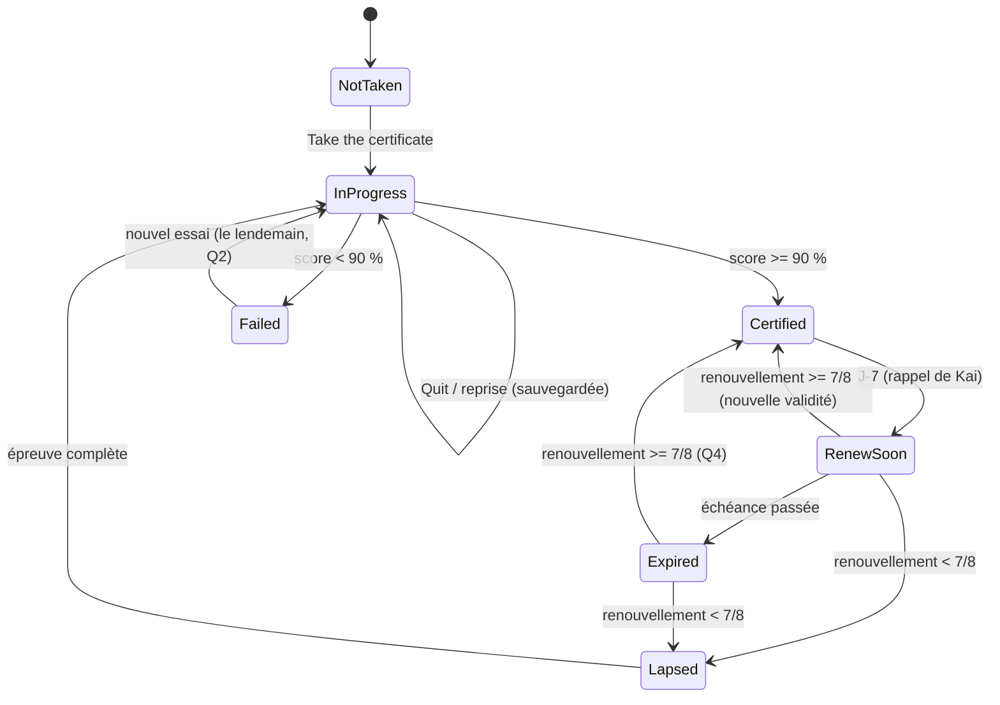

# Certificats de vocabulaire : conception des épreuves (sprint Kai 2, sprint A)

- **Auteur** : Matt (BA / UX), 02/11/2026. **Pour** : Ludo (moteur, `js/app-certificats.js`), Ouss (écrans, sprint B),
  Dédé (tests). **Décision** : le PO (Fabien).
- **Sources** : `docs/backlog/2026-10-30-retours-po.md` (R5, réponses du PO du 30/10, T1, T4), analyse UX du 30/10,
  rétro-doc fonctionnelle, lecture des données (`js/data/ndict.js`, `dict.js`, `lexiques.js`, `usage.js`,
  `themes-sensibles.js`, `kv.js`) et du code existant (« Type it » : `t3Ok`, `t3Typo` dans `js/app-v54-v62.js` ;
  distance d'édition `tkLev` dans `js/app-talk.js` ; filtre de niveau `lvOkWord` dans `js/app-usage.js`).
- Les chiffres par thème ont été **calculés sur les données du dépôt** (`kai/matt` @ `03d25bd`), filtre de niveau et
  thèmes sensibles appliqués comme le fait l'app.
- Ce document dit **quoi** ; Ludo choisit **comment** (noms de clés, structure des fonctions).
- **Aligné sur le moteur de Ludo** (`kai/ludo` @ `4f23278`, `js/app-certificats.js`, `docs/certificats/moteur.md`) :
  identifiants de formats, de thèmes et forme de `Cert.record` repris tels quels ; ce qui reste à ajuster au moteur
  est listé au §10.

---

## 0. En bref (les 6 décisions qui structurent tout)

1. **Un certificat = un « périmètre » de 8 à 20 mots** (25 pour un B1), pas un thème entier : un thème plus grand est
   découpé en parties (*Animals 1 · Pets & farm* = `nouns:animals-1`, *Family 1 · My family* = `nouns:family-1`…),
   un thème trop petit est regroupé avec un voisin. Ainsi **chaque mot du périmètre est interrogé au moins une fois**
   dans l'épreuve, et un certificat se passe en moins de 10 minutes. **Pas de certificat de verbes en v1.**
2. **Épreuve de 20 questions (Beginner) / 25 (B1), au moins 4 formats écrits**, un seul essai, ordre aléatoire,
   pas d'indice. Réussite : **≥ 90 % → 18/20 ou 23/25** (lecture retenue de « 90 % sur ≥ 3 formats », voir Q1).
3. **Pendant l'épreuve, on dit ✓ ou ✗ mais on ne montre jamais la bonne réponse** : un mot peut revenir une
   seconde fois dans un autre format ; montrer la réponse serait un indice. Les bonnes réponses arrivent à la fin,
   dans le **rattrapage** (« Fix your mistakes »), qui ne change pas la note mais compte pour la révision (R6).
4. **Un mot raté reste dans les mots du jour même si le thème est certifié** : le certificat ne sort de la rotation
   que les mots réussis ; un mot raté en sort après sa prochaine réussite dans un tour du jour (ajustement du
   moteur, §10).
5. **Tolérance « Type it » partout, sauf quand l'écart est grammatical** : une faute de frappe (distance 1, mot
   ≥ 5 lettres, pas un autre mot anglais) est acceptée avec « Watch the spelling » ; un pluriel, un accord, un ordre
   des mots faux restent faux (*brother* au lieu de *brothers* n'est pas une faute de frappe).
6. **Le son se choisit au début de l'épreuve** (« Can you use sound right now? », réponse mémorisée par élève) :
   sans son, la dictée est remplacée par des formats écrits ; **le micro n'est pas dans la v1** (Q3).

---

## 1. Règles validées par le PO (reprises telles quelles)

| # | Règle | Source |
|---|---|---|
| RC-01 | Épreuve **sans QCM**, formats mélangés ; dictée et micro **seulement si « son disponible ? » = oui**, choix fait au début de l'épreuve et **mémorisé** ; sans son, formats écrits de remplacement (usage dans le RER). | R5, PO 30/10 18:40 |
| RC-02 | **Réussite ≥ 90 % sur ≥ 3 formats**, **un seul essai** par question, **ordre aléatoire**, **pas d'indice**. | R5 |
| RC-03 | Faute de **frappe tolérée** (distance 1 sur mot ≥ 5 lettres, comme « Type it ») ; faute de **grammaire non**. | R5, S-08 |
| RC-04 | **Badge daté** ; page des certificats imprimable pour les parents. | R5 |
| RC-05 | **Validité 3 mois (6e) / 6 mois (B1–B2)**. | PO 30/10 18:43 |
| RC-06 | **Renouvellement : 8 questions, réussite 80 %**, tirage **pondéré vers les mots les moins fréquents et ceux déjà ratés** (éviter les mots trop simples). | PO 30/10 18:43 |
| RC-07 | **Rappel de Kai une semaine avant** l'échéance. | PO 30/10 18:43 |
| RC-08 | **Thème certifié sorti des mots du jour.** | R5 |
| RC-09 | **Échec au renouvellement → retour en révision.** | PO 30/10 18:40 |
| RC-10 | **Rattrapage** d'une épreuve : **ne change pas le résultat**, mais **compte pour la révision**. | R6, PO 30/10 18:46 |
| RC-11 | Vocabulaire d'abord (sprint Kai 2), grammaire au sprint suivant **avec le même moteur**. | PO 30/10 18:44 |
| RC-12 | Certificats **rangés avec la progression de chaque élève** et **inclus dans « Save & move »** ; modification manuelle du fichier acceptée (outil familial). | T1 |
| RC-13 | Tuile **Certificates** dans le menu principal : badges, expirations proches, « Take a certificate ». | T4 |

Précisions de calcul (pas de nouvelle règle, seulement l'arithmétique) :
- 90 % de 20 = **18/20** (2 erreurs permises) ; 90 % de 25 = 22,5 → **23/25** (2 erreurs permises).
- 80 % de 8 = 6,4 → **7/8** (1 erreur permise). Si le PO voulait 6/8, il faudrait dire « 75 % ».
- « 6e » = niveaux Beginner (A1) et Elementary (A2) ; « B1–B2 » = Intermediate et Upper-intermediate (`LV` dans
  `js/app-daily.js`). La validité dépend du **niveau de l'élève le jour où il obtient le certificat**.

---

## 2. Les formats d'épreuve

**Liste définitive des identifiants de formats** (ceux que Ludo a pris en attendant, gardés tels quels ; c'est la
valeur de `fmt` envoyée à `Cert.record` et le contenu de `formats` dans le stockage) :

| `fmt` | Format | Écrit / son | v1 |
|---|---|---|---|
| `type-fr-en` | Traduction FR → EN tapée | écrit | ✅ |
| `picture` | Image → mot tapé | écrit | ✅ |
| `gap` | Phrase à compléter sans propositions | écrit | ✅ |
| `order` | Remettre les mots dans l'ordre | écrit | ✅ |
| `fix` | Corriger l'erreur d'une phrase | écrit | ✅ |
| `dictation` | Kai dit, l'élève écrit | son | ✅ si son = oui |
| `speak` | Dire le mot au micro | son + micro | ❌ (Q3) |

Aucun autre identifiant : un nouveau format (grammaire au sprint suivant) s'ajoute à cette table d'abord.

Règles d'écran communes à tous les formats (Ouss) :
- En-tête fixe : nom du certificat, **barre de progression « 7 / 20 »**, bouton « Quit » (l'épreuve est
  **sauvegardée**, voir §6) ; pas de bouton retour à la question précédente.
- Libellé du format en petit au-dessus de la question (`Translate`, `What is it?`, `Complete`, `Put in order`,
  `Fix the mistake`, `Listen and write`), consigne en une ligne, en anglais, avec la traduction française en petit
  pour un Beginner (comme les leçons).
- Champ de saisie : `autocapitalize="off"`, `autocorrect="off"`, `spellcheck="false"`, `autocomplete="off"`,
  `enterkeyhint="done"` (sinon le correcteur de l'iPhone « aide » l'élève, ce qui serait un indice ; et il
  remplace parfois un mot juste par un mot faux). Taille de texte ≥ 18 px (R1), respect du réglage « Taille du texte » (T3).
- Bouton **Check** (désactivé si le champ est vide), puis retour : **✓ « Correct! »** ou **✗ « Not this time »**
  (+ « Watch the spelling » si faute de frappe tolérée, en montrant **uniquement l'orthographe du mot que l'élève
  a déjà trouvé**). **Jamais la bonne réponse d'une question ratée** pendant l'épreuve (décision 3). Bouton **Next**.
- Kai à côté, neutre (pas d'image *kai-cry*, cf. S-09) ; une petite bulle d'encouragement tous les 5 items.
- Pas de minuterie (enfant, dyslexie) ; durée indicative affichée au début.

### 2.1 `type-fr-en` — Traduction FR → EN tapée

**Déroulé**
1. Kai : « How do you say this in English? » ; au centre, en grand : le **mot français** tel qu'il est dans les
   données (`fr`), ex. « un oncle / tonton », « bleu(e) ».
2. L'élève tape le mot anglais, touche **Check**.
3. ✓ / ✗, **Next**.

**Données** : `fr` existe pour **tous** les mots (noms, adjectifs, adverbes, connecteurs, prépositions, verbes). Rien à créer.

**Correction**
- Réponses acceptées = le mot attendu **et tout mot du dictionnaire de même nature dont le `fr` (sans parenthèses ni
  article) est identique** : « une femme » accepte *woman* et *wife* ; « une fille » accepte *girl* et *daughter*
  (le français est ambigu, l'élève n'y est pour rien). Pour lever l'ambiguïté quand c'est possible, l'écran affiche
  le `fr` complet, parenthèse comprise (« une fille (l'enfant de…) » → *daughter* seulement).
- **Article ignoré** pour un nom (*a brother*, *the brother*, *brother* : juste), comme « Type it » (`t3Ok`).
  « to » ignoré pour un verbe.
- **Nombre exigé** : « un frère » → *brothers* est faux (grammaire). « les grands-parents » → *grandparents*.
- Variantes d'orthographe américaines acceptées avec une note (« In British English: *grey* ») si le mot a une
  variante déclarée (données à ajouter, §4).
- Faute de frappe : règle commune §3.

**Exemples**
| Thème | Affiché | Attendu | Accepté aussi | Refusé |
|---|---|---|---|---|
| Colours | violet / violette | purple | *purpel* (frappe, 6 lettres) | *violet* (mot français) |
| Colours | gris(e) | grey | *gray* (+ note UK) ; *grye* (inversion) | *gry* (3 lettres : distance 1 mais mot < 5 lettres) |
| Family | un oncle / tonton | uncle | *an uncle*, *the uncle* | *uncles* (nombre) |
| Family | une tante / tata | aunt | *an aunt* | *ant* (autre mot anglais), *aunty* (4 lettres attendues : pas de tolérance) |
| Family | les grands-parents (m) | grandparents | *grand parents* (espace : distance 1, ≥ 5 lettres) | *grandparent* (nombre) |

### 2.2 `picture` — Image → mot tapé

**Déroulé**
1. Kai : « What is it? » (ou « What colour is it? », « Who is it? ») ; au centre, une **grande image** (émoji de
   96 px dans une carte arrondie, ou petit dessin construit en HTML/CSS pour la famille, voir plus bas).
2. L'élève tape le mot, **Check**, ✓ / ✗, **Next**.

**Données**
- **Existe** : l'émoji `e` de chaque nom (1 089 noms sur 1 258 ont un émoji propre, différent de l'icône du thème).
- **Problème constaté** : beaucoup d'émojis sont **partagés** dans un même thème. *Family* : 👩 = *mother, mum,
  aunt, woman, stepmother* ; 👨 = *father, dad, uncle, man, stepfather* ; 👦 = *brother, son, nephew, boy* → sur
  43 mots éligibles d'un Beginner, **8 seulement** ont une image sans ambiguïté. Certains émojis sont trompeurs
  (🐈 pour *kitten* montre un chat adulte ; 🐕 pour *puppy* un chien adulte). Les **adjectifs n'ont aucune image**
  (Colours compris).
- **Règle** : une question `picture` n'est posée que si l'image est **unique dans tout le périmètre** et **validée**
  (drapeau `img` dans la banque, §4). Réponses acceptées = tous les mots du dictionnaire qui ont **le même émoji**
  (🐢 : *tortoise* et *turtle*).
- **Manque, à créer au sprint B (Matt, ≈ 0,1 dj)** :
  - **Colours** : un **objet** par couleur, tiré des phrases d'exemple existantes (pas une simple tache de couleur :
    un élève daltonien ne pourrait pas répondre) : 🍌 yellow, 🍓 red, 🐸 green, ❄️ white, 🦩 pink, 🍇 purple,
    🥕 orange, 🐘 grey, 🐻 brown, 🐈‍⬛ black, 🌊 blue. Consigne : « What colour is it? ».
  - **Family 1** : un **arbre généalogique** dessiné en HTML/CSS (cases avec émoji, l'élève au centre sous
    « You »), une case marquée « ? ». Consigne : « Who is this? It's your… ». 10 cases :
    *mother/mum, father/dad, brother, sister, grandmother/grandma, grandfather/grandpa, uncle, aunt, cousin,
    grandparents*. Coût pour Ouss ≈ 0,25 dj ; tant qu'il n'existe pas, `picture` n'est pas utilisé pour Family 1
    (les autres formats suffisent).
  - Les images de Kai (`SCN`, ≈ 50 noms) **ne sont pas utilisées** : ce sont des scènes (Kai à la plage) qui
    admettent plusieurs réponses.

**Correction** : comme `type-fr-en` (article ignoré, singulier attendu, frappe tolérée).

**Exemples** : 🍇 → *purple* ; 🐘 → *grey* (*gray* + note) ; arbre, case « la sœur de ta mère » → *aunt* ;
🐰 → *rabbit* (*bunny* refusé : absent du dictionnaire, Q9 n'est pas nécessaire, c'est la règle « mot du dictionnaire »).

### 2.3 `gap` — Phrase à compléter, sans propositions

**Déroulé**
1. Kai : « Complete the sentence. » ; la **phrase d'exemple anglaise avec un trou** (`_____`) à la place du mot
   cible ; en dessous, la **phrase française entière** (Beginner seulement ; masquée pour un B1, Q8).
2. L'élève tape le mot manquant **sous la forme exigée par la phrase** (pluriel, majuscule de début de phrase non exigée).
3. ✓ / ✗, **Next**.

**Données** : **existent** — chaque mot a **2 phrases d'exemple** EN + FR, mot cible entre `*…*` (même mécanique
que « Type it » : `t3Blank`). Filtre : cible de 3 mots maximum (déjà appliqué par `startT3`). Disponibles pour un
Beginner : Colours 18 phrases, Family 86, Animals 150, Clothes 68.
**Pourquoi la phrase française est montrée** : sans elle, « My _____ is a nurse. » admet *aunt, mother, sister…* :
la question serait injuste. Le français donne le sens, pas le mot anglais : ce n'est pas un indice au sens du PO.

**Correction**
- Attendu = le texte entre `*…*` (ex. *brothers*, *wives*, *Babies* → casse ignorée).
- **Forme grammaticale exigée** : *brother* pour *brothers* = faux, avec le message « Two brothers: plural! » à la fin
  (rattrapage). *wifes* pour *wives* = faux (pluriel irrégulier).
- Frappe tolérée (§3) seulement si l'écart **ne touche pas la terminaison du nombre**.

**Exemples**
- Colours : « Grapes can be _____. » / *Le raisin peut être violet.* → *purple*.
- Colours : « Snow is _____. » / *La neige est blanche.* → *white* ; *wite* accepté (frappe) ; *whit* accepté.
- Family : « I have three _____. » / *J'ai trois oncles.* → *uncles* ; *uncle* refusé.
- Family : « King Henry VIII had six _____. » / *Le roi Henri VIII a eu six épouses.* → *wives* ; *wifes* refusé.

### 2.4 `order` — Remettre les mots dans l'ordre

**Déroulé**
1. Kai : « Put the words in order. » ; la phrase française en dessous (Beginner) ; une **zone réponse** vide et,
   sous elle, les **mots en étiquettes mélangées** (cibles ≥ 44 px).
2. L'élève touche les étiquettes dans l'ordre (une étiquette touchée monte dans la réponse ; la toucher dans la
   réponse la renvoie en bas : corriger **avant** Check est permis, ce n'est pas un second essai).
3. La **majuscule initiale** et le **point final** sont ajoutés automatiquement (ils ne sont pas des étiquettes).
4. **Check** (actif quand toutes les étiquettes sont placées), ✓ / ✗, **Next**.

**Données** : **existent** — les phrases d'exemple. Filtre automatique : 4 à 8 mots, pas de virgule ni de
deux-points, pas de complément de temps déplaçable (*today, every day, always, on Saturday…*), sinon plusieurs
ordres sont justes. Disponibles pour un Beginner : Colours 10, Family 75, Animals 135.
**Manque** (rare) : un champ `alt` dans la banque pour déclarer un second ordre juste quand un humain le repère.

**Correction** : ordre **exact** de la phrase d'origine (ou d'un `alt`). Aucune tolérance : l'ordre des mots est
de la grammaire. Les étiquettes sont en minuscules sauf noms propres et *I*.

**Exemples**
- Colours : [eyes] [Kai] [blue] [has] → « Kai has blue eyes. » (*Kai has eyes blue* = faute typique d'un
  francophone, refusée).
- Colours : [white] [are] [trainers] [my] → « My trainers are white. »
- Family : [a] [nurse] [my] [is] [aunt] → « My aunt is a nurse. »
- Family : [brother] [twin] [have] [a] [I] → « I have a twin brother. »

### 2.5 `fix` — Corriger l'erreur d'une phrase

**Déroulé**
1. Kai : « There is one mistake. Tap it! » ; une phrase avec **une seule erreur**, mots en étiquettes touchables ;
   phrase française en dessous (Beginner).
2. **Étape 1** : l'élève touche le mot faux (un seul toucher, définitif).
   - Mauvais mot touché → ✗, l'item est perdu, **Next** (pas d'étape 2).
3. **Étape 2** : le mot touché devient un champ ; l'élève tape la correction, **Check**.
4. ✓ seulement si **les deux étapes** sont justes.

**Données** : **manquent entièrement**. Une erreur générée automatiquement est dangereuse (« My uncle is a nurse »
n'est pas une erreur). Elles sont **écrites à la main et relues** (Matt au sprint B, relecture du scrum master,
cf. CLAUDE.md « pédagogie juste »), **1 à 2 par mot**, sur des erreurs typiques d'un francophone portant sur le mot
du thème :
- adjectif accordé ou placé après le nom (*blues eyes*, *a car red*) ;
- pluriel oublié ou irrégulier mal formé (*two brother*, *childs*, *wifes*, *mouses*) ;
- mot français resté (*my tante*), faux ami fréquent ;
- confusion de genre dans le thème (*my uncle… she*) **seulement** si la phrase la rend certaine.
Format proposé dans la banque : `{w:"blue", s:"Kai has blues eyes.", bad:"blues", good:"blue", fr:"Kai a les yeux bleus."}`.

**Correction** : étape 1 exacte ; étape 2 = `good` avec tolérance de frappe §3 (sans toucher au nombre).

**Exemples**
- Colours : « Kai has *blues* eyes. » → toucher *blues* → taper *blue*.
- Colours : « I have a cat *black*. » → toucher *black*… Non : l'erreur est d'**ordre**, elle ne se corrige pas en
  un mot. **Règle** : `fix` ne contient que des erreurs corrigeables **en remplaçant un seul mot** (l'ordre est
  testé par `order`).
- Family : « I have two *brother*. » → *brothers*.
- Family : « The *childs* are playing in the park. » → *children* (Family 2).
- Family : « My *tante* is a nurse. » → *aunt*.

### 2.6 `dictation` — Dictée : Kai dit, l'élève écrit (seulement si son = oui)

**Déroulé**
1. À l'arrivée sur la question, Kai dit : **le mot, la phrase d'exemple, le mot** (« Brother. My big brother is 15.
   Brother. ») — la phrase lève les homophones (*son / sun*, *aunt / aren't*).
2. Boutons **Listen again** (2 fois au plus) et **Slow** (vitesse lente déjà existante). Ce ne sont pas des
   indices : on réécoute la même chose, comme dans une dictée en classe.
3. L'élève tape **le mot** (forme du dictionnaire, singulier) ; **Check**, ✓ / ✗, **Next**.

**Données** : le mot et sa phrase existent. **Voix** : enregistrement de Kai (`KV`) si disponible, sinon voix de
l'appareil en anglais britannique. Couverture constatée pour un Beginner : Colours **9/9** mots enregistrés,
Animals 72/75, **Family 0/43** (voix de l'appareil). Pas de donnée à créer ; si l'appareil n'a **aucune voix
anglaise**, le moteur répond « son indisponible » et bascule en formats écrits sans rien demander.

**Correction** : comme `type-fr-en` (article ignoré, frappe tolérée) ; une variante US est acceptée avec note.

**Exemples** : « Purple. Grapes can be purple. Purple. » → *purple* ; « Cousin. My cousin is the same age as me.
Cousin. » → *cousin* (*cousine* refusé : mot français).

### 2.7 `speak` — Dire le mot au micro (hors v1)

Proposé au sprint Kai 3 avec l'information micro des parents (S-18) : la reconnaissance vocale du navigateur
envoie la voix à Google (Chrome) ou Apple (Safari), ce qui touche la règle « enfant d'abord » ; elle se trompe
souvent sur un mot isolé dit par un enfant, et un faux échec dans une épreuve à essai unique serait injuste.
Hypothèse retenue : **pas de `speak` en v1** (Q3). Si le PO le veut : jamais compté faux quand la reconnaissance ne
renvoie rien (l'item devient `type-fr-en`).

### 2.8 Le choix du son

Écran avant la première question :
> Kai : « Can you use sound right now? » — **🔊 Yes, I can listen** / **🔇 No, silent mode (bus, train…)**
- Réponse **mémorisée par élève** et **présélectionnée** la fois suivante (toujours modifiable à cet écran).
- Son = non : **aucun son** n'est joué pendant l'épreuve (y compris les bulles de Kai et les sons de correction),
  aucune question `dictation`.
- Son = oui : questions `dictation` ajoutées (§5.2), bulles et bonne réponse lues dans le rattrapage.
- Le choix est stocké avec la tentative (pour les statistiques et les tests de Dédé).

---

## 3. Règles de correction communes (pour Ludo et Dédé)

Ordre d'application, sur la réponse tapée `a` et chaque réponse acceptée `e` :

1. **Normaliser** (comme `t3Norm`) : minuscules, apostrophes typographiques → `'`, ponctuation retirée,
   espaces multiples réduits, espaces de début et fin retirés.
2. **Exact** : `a == e` → juste.
3. **Article / to** (formats de mot `type-fr-en`, `picture`, `dictation` seulement) : `a` et `e` sans `a|an|the|to` en tête → juste.
4. **Variante déclarée** (`alt` : *gray*, *mom*…) → juste avec note « In British English: … ».
5. **Erreur de grammaire, jamais tolérée** : `a` est une **autre forme du même mot** (singulier ↔ pluriel, pluriel
   régulier fabriqué *wifes/childs/mouses*, comparatif, 3e personne…) ou l'écart porte sur la **terminaison du
   nombre** (`s`, `es`, `ies`, `ves`) → faux, avec un message de grammaire dans le rattrapage.
6. **Faute de frappe** : `e` compte **≥ 5 lettres** (lettres seules, espaces exclus), distance de
   Damerau-Levenshtein **= 1** (une lettre en trop, en moins, changée, ou **deux lettres inversées**, comme
   `tkLev`), et `a` **n'est pas un mot anglais connu** (`tkKnown`, comme `t3Typo` : *skirt* pour *shirt* reste faux)
   → **juste**, avec « Watch the spelling: *purple* ».
7. Sinon → **faux**.

Les items `order` (ordre exact) et l'étape 1 de `fix` (mot touché) n'ont aucune tolérance.

Cas de test pour Dédé (extraits ; la liste complète vit dans les tests du sprint B) :

| Attendu | Tapé | Résultat | Règle |
|---|---|---|---|
| purple | purpel | ✓ + spelling | 6 |
| purple | Purple. | ✓ | 1 |
| grey | gray | ✓ + note UK | 4 |
| grey | gry | ✗ | 6 (4 lettres attendues) |
| green | gren | ✓ + spelling | 6 (5 lettres) |
| red | rad | ✗ | 6 (< 5 lettres) |
| uncle | an uncle | ✓ | 3 |
| aunt | ant | ✗ | 6 (< 5 lettres, et *ant* est un mot) |
| brothers (GAP) | brother | ✗ | 5 (nombre) |
| wives (GAP) | wifes | ✗ | 5 (pluriel irrégulier) |
| grandmother | grandmohter | ✓ + spelling | 6 (inversion) |
| shirt | skirt | ✗ | 6 (mot connu) |

---

## 4. Données : ce qui existe, ce qui manque

| Besoin | Existe ? | Où / combien | À faire |
|---|---|---|---|
| Mot anglais, traduction | ✅ | `w`/`v`, `fr` pour tous les mots | — |
| 2 phrases d'exemple EN + FR, cible marquée | ✅ | `ex` (1 258 noms, 202 adjectifs…) ; 97 % font 3 à 9 mots | relecture des exemples par Ludo (Q8 du 30/10) avant le sprint B |
| Fréquence (1 rare – 3 très courant) et registre | ✅ | `f`, `r`, `USAGE` | — (sert au tirage du renouvellement) |
| Filtre niveau + thèmes sensibles | ✅ | `lvOkWord`, `sensOk` | le moteur l'applique au périmètre |
| Pluriel (dont irréguliers) | ✅ | `pl` (« — » si pas de pluriel) | — |
| Voix de Kai | ⚠️ partielle | `KV` : 764 textes, ≈ 300 noms ; Family 0 | rien : voix de l'appareil en secours |
| Images | ⚠️ ambiguës | émoji `e` (noms) ; aucun pour les adjectifs | drapeau `img` par mot (validé à la main) ; objets des 11 couleurs ; arbre Family 1 |
| **Périmètres des certificats** (titre, liste de mots, niveau) | ❌ | — | **banque de certificats**, écrite par Matt (§5.3) |
| **Phrases à erreur (`fix`)** | ❌ | — | 1 à 2 par mot, écrites à la main, relues |
| Variantes d'orthographe acceptées | ❌ | (la liste des contrôles `T6` en a quelques-unes : *gray*) | champ `alt` par mot dans la banque |
| Second ordre juste pour `order` | ❌ | — | champ `alt` par phrase, rarement nécessaire |
| Vocabulaire B1 (300 mots, thèmes de 1re) | ❌ | — | T2, sprint Kai 3 |

**Banque de certificats** : un fichier de données séparé (proposition : `js/data/certificats.js`, à charger après
les dictionnaires), relu comme les enrichissements. Il ne recopie pas les mots : il **référence** les clés existantes
(`nouns:brother`, `adjectives:purple`) et n'ajoute que ce qui manque (titre, parties, `img`, objets des couleurs,
phrases `fix`, `alt`). Un mot rangé dans deux thèmes (champ `also`) peut figurer dans deux périmètres, comme le fait
le moteur : il sort des mots du jour dès que l'un des deux est certifié.

---

## 5. Banque de questions par thème

### 5.1 Périmètre d'un certificat

- **Taille** : 8 à **20 mots** (Beginner / Elementary), 8 à **25 mots** (B1–B2). Au-delà, le thème est découpé en
  parties numérotées. Pourquoi : chaque mot doit être interrogé au moins une fois (sinon on sortirait des mots du
  jour un mot jamais testé), et l'épreuve doit tenir en moins de 10 minutes.
- **Contenu** : les mots du thème (`cat` ou `also`) **admis au niveau de l'élève** (`lvOkWord`), plus les mots des
  contrôles de la classe (`T6`) du thème même s'ils sont peu fréquents (ex. *purple*, *grey* sont « peu courants »
  dans les données mais au programme). Jamais un mot sensible en dessous du niveau 2.
- **Identifiant** : celui du moteur, `"<nature>:<catégorie>"` (`adjectives:colours`) quand le thème tient en un
  certificat ; `"<nature>:<catégorie>-<n>"` pour une partie (`nouns:family-1`, `nouns:animals-3`) ; un regroupement
  prend l'identifiant de son thème principal suffixé (`connectors:cause-plus`, voir le tableau). Tous respectent le
  format accepté par le moteur (`^[a-z]+:[a-z0-9_-]{1,40}$`).
- **Gros thèmes** (> 20 mots admis, > 25 pour un B1) : **découpés en parties** de 15 à 20 mots. Découpage écrit dans
  la banque (titres parlants : *Family 1 · My family*) ; à défaut, découpage automatique dans l'ordre des données
  (elles sont rangées par sous-thème), parties de tailles égales. Ex. `nouns:animals` (75 mots admis pour un
  Beginner) → 4 parties ; `nouns:house` (68) → 4 ; `nouns:family` (43) → 2.
- **Petits thèmes** (< 8 mots admis au niveau de l'élève) : **regroupés** avec le thème voisin désigné dans la
  banque ; sans voisin, non certifiables à ce niveau :

  | Thème trop petit (mots admis Beginner / B1) | Regroupé avec | Certificat (mots B1) |
  |---|---|---|
  | `connectors:start` (2 / 4) | `connectors:conclude` (1 / 6) | *Connectors · Start & finish* `connectors:conclude-plus` (10) — B1 seulement |
  | `connectors:condition` (5 / 5) | `connectors:cause` (9 / 16) | *Connectors · Cause & condition* `connectors:cause-plus` (21) — B1 seulement |
  | `adverbs:certainty` (4 / 7) | `adverbs:manner` (14 / 15) | *Adverbs · Manner & certainty* `adverbs:manner-plus` (18 / 22) |
  | `adjectives:size` (8 / 8) | `adjectives:looks` (9 / 10) | *Size & looks* `adjectives:looks-plus` (17 / 18) |
  | `adjectives:weather` (7 / 7) | `nouns:weather` (31) | *Weather 1–2* `nouns:weather-1`, `-2` (adjectifs répartis) |
  | `adjectives:feelings` (11) | `nouns:feelings` (35) | *Feelings 1–3* `nouns:feelings-1…3` |
  | `adjectives:money` (6), `adjectives:endoflife` (4 / 5) | `nouns:finance`, `nouns:endoflife` | B1 seulement (thèmes sensibles) |

- **Verbes : pas de certificat en v1.** Le moteur voit deux thèmes, `verbs:irregular` (≈ 90 verbes admis) et
  `verbs:regular` (128 admis pour un Beginner, 229 pour un B1) : rangés par forme, pas par sens, ils ne font pas de
  « thèmes » à certifier (une partie « regular 7 » ne veut rien dire pour un enfant), et le test des verbes
  irréguliers existe déjà dans *My weekly review*. Proposition pour le sprint suivant (avec la grammaire, même
  moteur) : paquets **par sens** écrits dans la banque (*Daily routine*, *Moving*, *Feelings & thinking*, *School
  verbs*…, 15–20 verbes) et un certificat *Irregular verbs 1–5* (20 verbes, formats `type-fr-en` + prétérit et
  participe tapés). → Q11. L'écran **ne propose pas** `verbs:*` en v1 (le moteur peut les garder techniquement).
- **Certifiable** pour un niveau si : ≥ 8 mots admis, et au moins **4 formats écrits** disposent d'assez de
  matière (`type-fr-en` toujours ; `gap` et `order` d'après les phrases ; `picture` ou `fix` d'après la banque).
- **Prêt** (suggestion de Kai, jamais un blocage) : ≥ 80 % des mots du périmètre ont été réussis dans les tours du
  jour. Un élève peut passer un certificat sans être « prêt » (Léo connaît peut-être déjà les couleurs).

### 5.2 Composition d'une épreuve

| | Beginner / Elementary, **sans son** | Beginner / Elementary, **avec son** | B1–B2, sans son | B1–B2, avec son |
|---|---|---|---|---|
| `type-fr-en` traduction | 6 | 4 | 7 | 5 |
| `picture` image | 4 | 4 | 3 | 3 |
| `gap` phrase à compléter | 5 | 4 | 7 | 6 |
| `order` ordre des mots | 3 | 3 | 4 | 4 |
| `fix` corriger l'erreur | 2 | 2 | 4 | 4 |
| `dictation` dictée | — | 3 | — | 3 |
| **Total / réussite** | **20 / 18** | **20 / 18** | **25 / 23** | **25 / 23** |
| Durée estimée | ≈ 7 min | ≈ 8 min | ≈ 10 min | ≈ 11 min |

- **Pas assez d'images** (`picture` < 4 dans le périmètre) : les questions `picture` manquantes passent en `type-fr-en` (moitié)
  et `gap` (moitié). Pas de phrase `fix` écrite : `fix` passe en `gap`. L'épreuve garde **au moins 4 formats**
  (donc toujours ≥ 3, règle RC-02, même si un format tombe).
- B1 : `order` sur les phrases de 6 à 12 mots ; phrase française masquée (Q8) ; pour les connecteurs, `gap` et `fix`
  sont les formats rois (*However / Although / Despite*), `picture` n'existe pas (remplacé comme ci-dessus).

### 5.3 Tirage des questions (algorithme attendu de Ludo)

1. **Couverture** : chaque mot du périmètre reçoit une question ; les questions restantes vont en priorité aux
   mots **jamais certifiés**, puis **ratés dans les tours du jour** (« Words you often miss »), puis **les moins
   fréquents** (`f` = 1). Un mot apparaît **au plus 2 fois**, et jamais 2 fois dans le même format.
2. **Format** : chaque question prend un format disponible pour ce mot (image validée, phrase utilisable…) en
   remplissant les quotas du tableau.
3. **Phrase** : pour `gap` et `order`, une des 2 phrases d'exemple (au hasard) ; un même mot ne réutilise pas la
   même phrase deux fois.
4. **Ordre aléatoire**, avec **une seule contrainte** : une question qui **affiche** un mot anglais (`order`, et le
   bon mot visible dans la phrase d'un `fix`) ne vient **jamais avant** une question qui demande de **produire** ce
   même mot (`type-fr-en`, `picture`, `gap`, `dictation`). Sinon l'élève lirait la réponse avant qu'on la lui demande. (Mélanger,
   puis échanger les paires en défaut.)
5. **Pas de tirage identique** d'une tentative à l'autre (nouveau mélange, autres phrases si possible).

### 5.4 Thèmes certifiables au départ

**Beginner / Elementary (6e)** — thèmes « cœur 6e » (S-12) ; nombre de mots admis pour un Beginner (filtre de
niveau + mots des contrôles `T6`) → parties. Abréviations : TR `type-fr-en`, PIC `picture`, GAP `gap`, ORD `order`,
FIX `fix` ; `*` = matière à écrire dans la banque (§4).

| Certificat | Identifiant(s) | Mots | Parties | Formats écrits | Remarque |
|---|---|---|---|---|---|
| **Colours** | `adjectives:colours` | 11 | 1 | TR, PIC*, GAP, ORD, FIX* | tous au contrôle `T6` du 02/11 (*purple*, *grey* sont « peu courants » dans les données mais au programme) |
| **Family** | `nouns:family-1`, `-2` | 43 | 2 : *My family* (18), *People around me* (20) | TR, PIC* (arbre), GAP, ORD, FIX* | *name, age, first name, surname, crowd* vont à Identity |
| Animals | `nouns:animals-1` … `-4` | 77 | 4 (≈ 19) | TR, **PIC** (57 images uniques), GAP, ORD, FIX* | 13 mots au contrôle `T6` |
| Personality | `adjectives:personality-1`, `-2` | 34 | 2 | TR, GAP, ORD, FIX* | 13 mots au contrôle `T6` ; pas d'image |
| Clothes | `nouns:clothes-1`, `-2` | 34 | 2 | TR, PIC (17), GAP, ORD, FIX* | |
| Body | `nouns:body-1` … `-3` | 43 | 3 | TR, PIC (21), GAP, ORD, FIX* | |
| House | `nouns:house-1` … `-4` | 68 | 4 | TR, PIC (25), GAP, ORD, FIX* | |
| School | `nouns:school-1` … `-3` | 44 | 3 | TR, PIC (29), GAP, ORD, FIX* | |
| Food & drinks / Fruit & veg | `nouns:food-1…3` / `nouns:fruitveg-1`, `-2` | 47 / 30 | 3 / 2 | TR, PIC, GAP, ORD, FIX* | |
| Sports / Games | `nouns:sports-1`, `-2` / `nouns:games-1`, `-2` | 30 / 26 | 2 / 2 | TR, PIC, GAP, ORD, FIX* | |
| Weather (+ adjectifs météo) | `nouns:weather-1`, `-2` | 31 + 7 | 2 | TR, PIC (20), GAP, ORD, FIX* | |
| Time / Numbers | `nouns:time-1…3` / `nouns:numbers-1`, `-2` | 47 / 36 | 3 / 2 | TR, GAP, ORD, FIX* | *Numbers* : images inutilisables (4) |
| Places / Countries / Identity | `nouns:places-1…3` / `nouns:countries-1`, `-2` / `nouns:identity` | 44 / 23 / 16 (+5) | 3 / 2 / 1 | TR, PIC, GAP, ORD, FIX* | pays : majuscule non exigée, note « Capital letter » |
| Feelings (noms + adjectifs) | `nouns:feelings-1` … `-3` | 35 + 11 | 3 | TR, PIC, GAP, ORD, FIX* | |
| Size & looks | `adjectives:looks-plus` | 17 | 1 | TR, GAP, ORD, FIX* | regroupement (§5.1) |
| Prepositions · Place | `prepositions:place-1`, `-2` | 27 | 2 | TR, GAP, ORD, FIX* | |

**Non proposés à un Beginner** : War, Money & finance, End of life, Justice (thèmes sensibles), Textiles,
Household linen, At the table, Flowers, History, Studies, Science & tech, Arts, Music, Jobs, Nationalities, Opinion,
adverbes, connecteurs et verbes (hors programme 6e, trop peu de mots admis, ou pas en v1). Ils deviennent
proposables au niveau où leurs mots sont admis. Le moteur garde les 63 thèmes « techniques » ; c'est la banque qui
dit lesquels l'écran propose, à quel niveau, et comment ils sont découpés ou regroupés.

**B1 (le lycéen)** — en attendant les 300 mots des thèmes de 1re (T2, sprint Kai 3), proposables dès maintenant
avec le filtre du niveau Intermediate :

| Certificat | Identifiant | Mots admis (B1) | Parties | Intérêt pour un élève de 1re |
|---|---|---|---|---|
| **Connectors · Contrast** | `connectors:contrast` | 16 | 1 | *however, although, despite, whereas* : cœur de l'expression écrite au bac |
| **Connectors · Cause & condition** | `connectors:cause-plus` | 16 + 5 | 1 | *therefore, as a result, due to, unless, provided that* |
| **Connectors · Adding** | `connectors:adding` | 12 | 1 | *moreover, furthermore, in addition* |
| Connectors · Start & finish | `connectors:conclude-plus` | 4 + 6 | 1 | *first of all, to begin with, in conclusion, to sum up* |
| Opinion (adjectifs) | `adjectives:opinion` | 19 | 1 | argumentation |
| Science & tech | `nouns:science-1`, `-2` | 48 | 2 | thème de 1re « innovations scientifiques » |
| Studies | `nouns:studies-1` … `-3` | 54 | 3 | |
| Jobs / Travel | `nouns:jobs-1`, `-2` / `nouns:travel-1`, `-2` | 35 / 46 | 2 / 2 | |
Les thèmes « 6e » restent certifiables pour lui (validité 6 mois) mais ne lui sont pas suggérés.

### 5.5 Les 3 premiers certificats proposés pour le sprint B

1. **Colours** `adjectives:colours` (11 mots : *red, blue, green, yellow, orange, pink, purple, brown, black, white, grey*). Court,
   connu, au contrôle de la classe : idéal pour roder l'épreuve. 20 questions = chaque couleur 1 à 2 fois.
   Matière à écrire : 11 objets `picture`, 11 phrases `fix`, `alt` *gray*.
2. **Family 1 · My family** `nouns:family-1` (18 mots : *family, parent, mother, mum, father, dad, brother, sister, son, daughter,
   grandmother, grandfather, grandma, grandpa, grandparents, uncle, aunt, cousin*). Matière à écrire : 18 phrases
   `fix` (pluriels, *tante*, accords), drapeaux `img`, arbre (Ouss, facultatif) ; `alt` *mom* (pour *mum*, Q9).
3. **Animals 1 · Pets & farm** `nouns:animals-1` (20 mots : *pet, dog, puppy, cat, kitten, rabbit, mouse, goldfish, parrot, tortoise,
   horse, pony, donkey, cow, pig, sheep, lamb, goat, hen, duck*). Proposé parce qu'il est **le seul des trois à
   exercer pleinement le format image** (14 images valides après retrait de *puppy, kitten* : émojis d'adultes ;
   *horse/pony* et *sheep/lamb* : émojis partagés ; *pet, donkey* : icône du thème) et parce que les animaux sont au
   contrôle Unit 1. Alternative : *Personality 1* (au contrôle aussi, mais sans image). → Q5.

Volume à écrire par Matt au sprint B : ≈ 50 phrases `fix` + 25 drapeaux d'image + 11 objets de couleur ≈ 0,5 dj,
relecture du scrum master ≈ 0,15 dj.

---

## 6. Cycle de vie d'un certificat



- **InProgress** : l'épreuve est sauvegardée à chaque réponse (le RER coupe, l'iPhone ferme l'onglet). Au retour :
  « Continue your certificate » ; **pas de « recommencer »** tant qu'elle n'est pas finie (sinon on pourrait
  abandonner une épreuve mal partie : ce serait un second essai). Une épreuve non reprise sous 7 jours est
  abandonnée **sans compter comme échec**.
- **Certified** : badge daté (« Certified on 2 November 2026 · 19/20 »), date d'échéance (+3 mois ou +6 mois selon
  le niveau du jour d'obtention). Les mots **réussis** sortent des mots du jour (nouveaux et à revoir) et de « Words
  you often miss » ; ils restent dans les dictionnaires, les quiz choisis et « Do it yourself ». Les mots **ratés**
  restent dans les mots du jour jusqu'à leur prochaine réussite dans un tour (décision 4). Les mots certifiés
  comptent comme « connus » pour le passage de niveau (Q7).
- **RenewSoon** (J-7) : Kai le dit dans My daily work (« Your *Colours* certificate ends in 7 days. Renew it: 8
  questions, 2 minutes! »), une fois par jour au plus, jusqu'au renouvellement ; pastille sur la tuile Certificates.
- **Renouvellement** : 8 questions, réussite **7/8**, formats écrits `type-fr-en`, `gap`, `fix` (+ `dictation` si son), au moins
  2 formats, un seul essai, pas d'indice. **Tirage pondéré** sur tout le périmètre, sans remise, **formule du moteur
  de Ludo (`Cert.pickRenewal`) adoptée** : poids de fréquence (`f` = 1 rare → ×4, 2 → ×2, 3 très courant → ×1) ×
  (1 + 1,5 × ratés, plafonné à 4), `ratés` = échecs du mot dans les tours du jour et aux épreuves. Ex. Colours :
  *red* (f 3, jamais raté) = 1 ; *grey* (f 1, raté 2 fois) = 4 × 4 = 16. L'écran passe
  `formats: ["type-fr-en", "gap", "fix"]` (+ `"dictation"` si son = oui) ; le moteur les distribue à tour de rôle.
  Réussite → échéance prolongée de 3 ou 6 mois **à partir de l'échéance si elle n'est pas passée** (on ne perd pas
  les jours restants, choix de Ludo adopté), sinon à partir du jour même (« Renewed on … »).
  Échec → **Lapsed** (statut `review` du moteur) : badge grisé (l'historique est gardé), **tous les mots du périmètre
  reviennent dans les mots du jour** (RC-09) ; pour retrouver le badge, épreuve complète.
- **Expired** (échéance passée sans renouvellement) : les mots reviennent dans les mots du jour avec leur état de
  mémoire ; le badge affiche « Expired · renew it » ; renouvellement court encore possible pendant une durée de
  validité, puis épreuve complète (Q4).

**Rattrapage (« Fix your mistakes », R6)** — à la fin de chaque épreuve ou renouvellement, réussi ou non :
1. Écran de résultat : score, ✓ / ✗ par format, badge ou « So close! 17/20 ».
2. Pour chaque question ratée : la question revient **avec la bonne réponse affichée** (et lue si son = oui),
   l'élève touche « Got it », la réponse disparaît, il la **tape**. Une explication de grammaire courte quand la
   règle 5 s'est appliquée (« Two brothers: plural! »).
3. Effets : **la note ne change pas** ; chaque mot rattrapé gagne une **étoile de rattrapage** et le compteur
   « words fixed » (R6) ; pour la mémoire des mots, le mot est **raté puis corrigé** (comme `fx` dans un tour du
   jour) : il revient plus tôt dans les mots du jour.

---

## 7. Stockage : besoins pour Ludo (lié à T1)

Ludo choisit les clés et la structure ; voici ce qui doit être possible. **État au 02/11** (moteur `kai/ludo` @
`4f23278`) : ✅ = couvert par le moteur ; ⚠️ = à ajouter (détail au §10).

**Où et avec qui**
- ✅ B-01 Les certificats sont **rattachés à un élève** (identifiant du profil) et supprimés avec lui.
- ✅ B-02 Ils sont **dans le fichier « Save & move »**. Une clé `kai.*` y est déjà exportée automatiquement. **Attention,
  constat dans le code** : à l'import (`kaiMerge`, `js/app-v51-sauvegarde.js`), une clé autre que les profils et les
  jours n'est copiée **que si elle est absente** sur l'appareil. Pour les certificats, il faut une **fusion** :
  certificat par certificat, la donnée la plus récente gagne ; les tentatives des deux appareils sont **réunies**
  (identifiant unique par tentative). Sinon un certificat obtenu sur le téléphone ne passerait pas sur la tablette
  si un autre certificat y existe déjà.
- ✅ B-03 Format **lisible et modifiable à la main** (JSON simple, dates `AAAA-MM-JJ`, pas d'empreinte qui bloquerait
  une correction manuelle : décision T1).
- ✅ B-04 Un numéro de version du format, et un **identifiant de certificat stable** qui marche aussi pour la grammaire
  (ex. `nouns:family#1`, `adjectives:colours`, plus tard `grammar:present-simple`).

**Ce qu'il faut retenir, par élève**
- ⚠️ B-05 Le **choix du son** (dernier choix, présélectionné).
- ✅ B-06 Par certificat : état (§6), date d'obtention, date du dernier renouvellement, **date d'échéance**, niveau de
  l'élève à l'obtention (qui fixe 3 ou 6 mois), meilleur score, date du dernier rappel affiché.
- ⚠️ B-07 Par tentative (épreuve ou renouvellement) : identifiant, date et heure, type (complète / renouvellement), son
  oui / non, nombre de questions, score, score par format, et **le résultat par mot** (clé du mot `nouns:brother`,
  juste / faux / rattrapé) : c'est ce qui permet la pondération « déjà ratés », la sortie des seuls mots réussis et
  le compteur de rattrapage.
- ⚠️ B-08 L'**épreuve en cours** (questions tirées, réponses déjà données, position) pour la reprise, à part du reste,
  non indispensable dans « Save & move ».
- ⚠️ B-09 Les mots des contrôles et des tours du jour **ne sont pas recopiés** : le moteur lit la mémoire existante
  (`kai.daily.v1.<id>`) et y **écrit** les mots ratés / rattrapés d'une épreuve comme le fait un tour du jour
  (activité d'un type nouveau, **exclue** de la moyenne « Average score, last 10 quizzes » et des étoiles du jour
  ordinaires — à confirmer par Ludo selon `lvProgress` et `starsOf`).

**Ce que le moteur doit savoir répondre (pour Ouss et pour `pickMix`)**
- ✅ B-10 « Ce mot est-il exclu des mots du jour aujourd'hui ? » (rapide : appelé pour chaque mot à chaque tour).
- ✅ B-11 Liste des certificats de l'élève avec état et jours restants ; ceux à J-7 ; ceux « prêts » à passer.
- ⚠️ B-12 Construire une épreuve ou un renouvellement (liste de questions) pour un certificat, un niveau et un choix de
  son ; corriger une réponse (règles §3) ; enregistrer une tentative.

---

## 8. Écrans à produire au sprint B (rappel pour Ouss)

1. **Certificates** (tuile du menu, T4) : badges obtenus (date, échéance, « 12 days left » en orange à J-7),
   « Take a certificate » (suggestions « Ready » en premier), « Renew » en tête de liste quand c'est le moment.
   Place dans My daily work : voir les maquettes `docs/ux/maquettes-daily/`.
2. **Avant l'épreuve** : titre, mots du périmètre **non montrés** (ce serait une révision, mais pas un indice :
   à décider à l'usage), règles en 3 lignes (« 20 questions · one try each · no hints · 18 to pass · ≈ 7 min »),
   choix du son, **Start**.
3. **Question** (6 formats, §2), **résultat**, **rattrapage**, **badge** (animation sobre, confettis existants).
4. **Page imprimable** pour les parents : nom de l'élève, certificats, dates, scores (CSS `@media print`).

---

## 9. Questions au PO

| # | Question | Hypothèse par défaut (appliquée si pas de réponse) | Ce que change l'autre réponse |
|---|---|---|---|
| Q1 | « ≥ 90 % sur ≥ 3 formats » : note **globale** ≥ 90 % avec au moins 3 formats dans l'épreuve, ou ≥ 90 % **dans chacun** d'au moins 3 formats ? | **Globale** (18/20), épreuve d'au moins 4 formats. | « Dans chacun » : avec 4–6 questions par format, 90 % = zéro faute par format : très dur pour un enfant ; il faudrait des épreuves de 30+ questions. |
| Q2 | Après un échec, quand peut-on retenter ? | **Le lendemain** (le temps de revoir les mots ratés ; évite de repasser en boucle). | « Tout de suite » : rien à coder de plus, mais la note mesure la mémoire immédiate. |
| Q3 | Micro dans les épreuves dès cette version ? | **Non** (sprint Kai 3, avec l'information des parents S-18). | Oui : +0,5 dj, avertissement micro obligatoire avant (règle « enfant d'abord »). |
| Q4 | Certificat échu sans renouvellement : jusqu'à quand le renouvellement court (8 questions) reste-t-il possible ? | Pendant **une durée de validité** après l'échéance (3 ou 6 mois), puis épreuve complète. Les mots reviennent dans les mots du jour **dès l'échéance**. | « Jamais après l'échéance » : plus simple, plus strict. |
| Q5 | 3e certificat du sprint B : *Animals 1 · Pets & farm* ? | **Animals 1** (seul à tester vraiment le format image). | *Personality 1* ou *Clothes 1* : même effort. |
| Q6 | Découper les grands thèmes en parties de 20 mots au plus (Family en 2, Animals en 4) ? | **Oui.** | Thème entier : épreuves de 40+ questions, ou mots certifiés sans avoir été interrogés. |
| Q7 | Les mots certifiés comptent-ils comme « Words you know » pour passer au niveau suivant ? | **Oui** (même jamais vus en tour du jour). | Non : un élève qui certifie beaucoup monte moins vite. |
| Q8 | Phrase française montrée sous les questions `gap`, `order`, `fix` ? | **Oui pour 6e, non pour B1.** | Toujours / jamais. |
| Q9 | Orthographe américaine (*gray*, *mom*, *color*) : juste avec une note, ou fausse ? | **Juste avec la note** « In British English: grey ». | Fausse : plus conforme au programme, plus frustrant. |
| Q10 | Récompense d'un certificat dans le système d'étoiles ? | **+10 étoiles** à l'obtention, **+5** au renouvellement, aucune nouvelle « monnaie » (I-05 : il y en a déjà trop). | Une médaille à part : plus visible, une monnaie de plus. |
| Q11 | Certificats de **verbes** : en v1, ou au sprint suivant avec la grammaire, par paquets **de sens** de 15–20 verbes (+ *Irregular verbs 1–5*) ? (= Q3 de Ludo) | **Pas en v1** ; paquets de sens au sprint suivant. | En v1 : ≈ 0,25 dj de banque (paquets) + format prétérit / participe tapés. |
| Q12 | Thèmes de moins de 8 mots : **regroupés** avec un voisin (tableau §5.1), plutôt qu'un renouvellement plus court ? (= Q2 de Ludo) | **Regroupés.** | Renouvellement plus court : 4 à 7 questions, une erreur = échec. |
| Q13 | Un certificat encore valable et une épreuve **ratée** (repassée « pour le plaisir ») : on garde le certificat ? (= Q1 de Ludo) | **Oui, on le garde** ; la tentative compte pour la révision (mots ratés) comme un rattrapage. | Non : un enfant n'oserait plus repasser une épreuve. |

Mon avis sur les autres questions de Ludo (`docs/certificats/moteur.md`) : **Q4** (changement de niveau pendant la
validité → on garde l'échéance obtenue, nouvelle durée au prochain renouvellement) : d'accord ; **Q5** (synchro
par la base de l'artefact Claude) : inutile sur GitHub Pages, à ne faire que si le PO utilise la version artefact.

---

## 10. Alignement avec le moteur de Ludo (`kai/ludo` @ `4f23278`)

Ce qui colle déjà : identifiant de thème `"<nature>:<catégorie>"`, validité 3 / 6 mois selon le niveau à
l'obtention, `Cert.passExam` (≥ 90 % **global** et ≥ 3 formats = hypothèse de Q1), `Cert.scoreRenewal` (7/8),
`Cert.pickRenewal` (pondération mots rares / ratés, adoptée telle quelle), `Cert.dueSoon(élève, 7)` pour le rappel,
sortie de rotation et retour en révision, fusion « Save & move » thème par thème, assainissement d'un fichier
modifié à la main.

**Contrat de l'écran d'épreuve (Ouss, sprint B)** — à la fin d'une épreuve ou d'un renouvellement, **avant** le
rattrapage :
```js
Cert.record(pid, "nouns:family-1", {
  kind: "exam",                       // ou "renewal"
  items: [                            // une ligne PAR QUESTION (un mot interrogé 2 fois = 2 lignes)
    { key: "nouns:brother",   fmt: "type-fr-en", ok: true  },
    { key: "nouns:aunt",      fmt: "gap",        ok: false },
    { key: "adjectives:grey", fmt: "dictation",  ok: true  }   // clé du mot = clé de allWords() : "<nature>:<w ou v>"
  ]
});
```
- `key` = **la clé du mot** (`"nouns:dog"`, `"adjectives:purple"`), obligatoire pour que les mots ratés pèsent dans
  le prochain renouvellement (`missed`) ; jamais la forme interrogée (*brothers*) ni le texte tapé.
- `fmt` ∈ la table du §2 ; `ok` = verdict **de l'épreuve** (une faute de frappe tolérée compte `true`).
- Le **rattrapage n'est pas envoyé** à `Cert.record` (il ne change pas le résultat, RC-10) : il est écrit dans la
  mémoire des mots (B-09).

**À ajouter au moteur (sprint B, Ludo)**
1. **Périmètres** : le moteur certifie aujourd'hui un thème entier. Il faut qu'il accepte les identifiants de la
   banque (`nouns:family-1`, `adjectives:looks-plus`) et prenne leurs mots dans la banque (`js/data/certificats.js`,
   §4) ; `Cert.themes()` rend alors la liste **de la banque** filtrée par niveau, et `Cert.themeWords()` les mots
   du périmètre. Sans entrée dans la banque, comportement actuel (thème entier).
2. **Mots ratés restent en rotation** (décision 4) : aujourd'hui un thème certifié sort **entier** des mots du jour.
   Demande : `inRotation` rend vrai pour un mot de `missed` tant qu'il n'a pas été réussi dans un tour du jour
   postérieur à l'épreuve.
3. **Tirage d'une épreuve complète** (§5.2–5.3) : `Cert.pickExam(élève, périmètre, { sound })` → 20 ou 25 questions
   `{ key, fmt, ex? }` avec couverture de tous les mots, quotas de formats, contrainte d'ordre « afficher après
   produire ».
4. **Correction** (§3) : une fonction `Cert.check(question, tapé)` → `{ ok, typo, grammar, note }`, réutilisant
   `t3Norm`, `tkLev`, `tkKnown`, `tvars` (pour que l'écran et les tests de Dédé partagent la même règle).
5. **Choix du son** mémorisé par élève (B-05) et **épreuve en cours** pour la reprise (B-08), hors fichier de
   certificats si Ludo préfère (clé `kai.csave.<id>` sur le modèle de `kai.qsave.*`).
6. **Tentatives** : `history` garde date, type, score, réussite ; ajouter `sound` (oui / non) et le score par format
   (`formats` n'en garde que la liste) si c'est peu coûteux — utile pour Dédé et pour la page des parents, pas
   bloquant.
7. **Rattrapage → mémoire** (B-09) : écrire les mots ratés / rattrapés dans `kai.daily.v1.<id>` (activité de type
   `cert-*`, exclue de la moyenne des 10 derniers quiz et des étoiles ordinaires).
