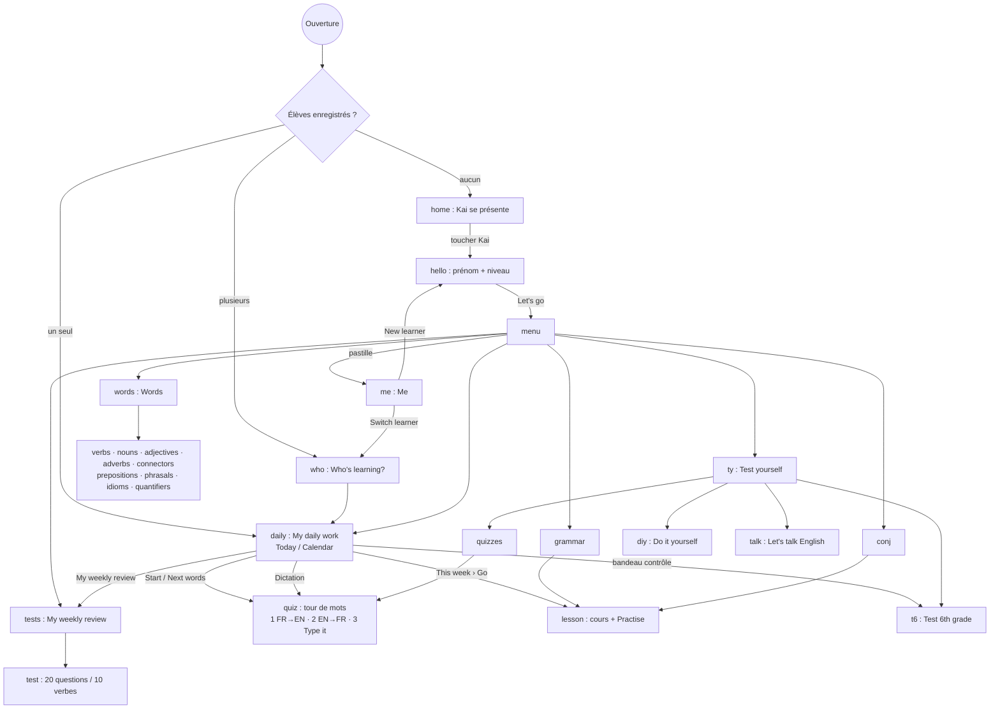

# Learning English with Kai — rétro-documentation fonctionnelle

- **Rédigée par** : Matt (BA / UX), sprint Kai 1, 30/10/2026
- **Version décrite** : `main` @ `51efca8` + PR #1 (« Version du 16 octobre 2026 », écran d'accueil `v0.2`)
- **Méthode** : parcours réel de l'application (Playwright + Chromium, 390×844 et 1280×800, captures dans
  `/tmp/kai-matt/`, non versionnées) et lecture ciblée de `index.html`. Les numéros de ligne renvoient à
  `index.html` **avant** le découpage de Ludo : ils serviront à retrouver le code dans `js/app.js`.
- **Ce document décrit ce que fait l'application, pas ce qu'elle devrait faire.** Les critiques sont dans
  `docs/ux/analyse-ux-2026-10-30.md`.

---

## 1. En une phrase

Une application web d'une seule page, sans compte ni serveur, où un élève de 6e apprend chaque jour une
série de mots anglais avec Kai (personnage manga), suit des leçons de grammaire et de conjugaison, passe des
tests notés sur 20 et gagne des étoiles. Tout est enregistré dans le navigateur de l'appareil.

## 2. Écrans

Chaque écran est un `<main class="page" id="…">` ; un seul est visible à la fois (`show(id)`).
L'interface est **en anglais**, les explications de grammaire et les traductions sont **en français**.

| # | Écran (`id`) | Titre affiché | Rôle | Accès |
|---|---|---|---|---|
| 1 | `home` | Learning English with Kai | Accueil animé : Kai se présente (2 bulles, voix enregistrée) | Premier lancement |
| 2 | `hello` | Hello! | Créer un élève : prénom (16 car. max) + niveau (4 cartes, Beginner présélectionné) | Toucher Kai (1re fois), « New learner » |
| 3 | `who` | Who's learning? | Choisir l'élève quand il y en a plusieurs | Démarrage avec ≥ 2 élèves, « Switch learner » |
| 4 | `menu` | Menu | 6 grandes tuiles + pastille de l'élève (initiale) en haut à droite | Retour depuis les écrans de 1er niveau |
| 5 | `daily` | My daily work | Le tableau de bord du jour (onglets **Today** / **Calendar**) | Démarrage direct d'un élève connu ; tuile 1 |
| 6 | `quiz` | Words of the day / Quiz … | Tour de mots en 3 parties ; sert aussi à la dictée | Daily › Start ; Quiz ; Dictation |
| 7 | `words` | Words | Recherche globale + 9 tuiles de listes | Tuile 2 |
| 8 | `verbs`, `nouns`, `adjectives`, `adverbs`, `connectors`, `prepositions`, `phrasals`, `idioms`, `quantifiers` | idem | Dictionnaires : recherche FR/EN, filtres par thème (puces), fiches dépliables | Words › tuile |
| 9 | `grammar` | Grammar | Liste des 20 leçons, « leçon de la semaine », étoiles | Tuile 3 |
| 10 | `conj` | Conjugation | Liste des 13 leçons (be, have + 11 temps) | Tuile 4 |
| 11 | `lesson` | (titre de la leçon) | Cours (tableaux, exemples audio, pièges) puis **Practise** (10 QCM) | Grammar / Conjugation / Daily › This week |
| 12 | `tests` | My weekly review | Notes de la semaine, 3 tests (grammaire, conjugaison, verbes irréguliers) | Tuile 5 ; Daily › My tests |
| 13 | `test` | Grammar test… | Test de 20 questions (dont 7 à écrire) ou 10 verbes irréguliers | Tests › carte |
| 14 | `ty` | Test yourself | 4 tuiles : Test 6th grade, Quiz, Do it yourself, Let's talk English | Tuile 6 |
| 15 | `t6` | Test 6th grade | Contrôles de la classe (dates en dur), liste de mots, test EN→FR / FR→EN | Test yourself ; bandeau « Class test in N days » |
| 16 | `quizzes` | Quiz | 9 quiz (verbes, noms, adjectifs, adverbes, connecteurs, prépositions, phrasal verbs, idioms) + dictée | Test yourself › Quiz |
| 17 | `diy` | Do it yourself | Révision à la carte : thèmes cochés (mots, grammaire, conjugaison), mode, 10/20/30 questions | Test yourself |
| 18 | `talk` | Let's talk English | Une image, une question ; l'élève dit ou tape une phrase ; Kai l'analyse | Test yourself |
| 19 | `me` | Me | Élève (renommer, changer, créer), niveau, voix de Kai, vitesse, Save & move, code parent, suppression | Pastille en haut à droite du menu |
| — | `#modal` | (variable) | Fenêtre : reprise d'un tour, code parent, aides (étoiles, registre), traduction FR | Partout |
| — | `#toast` | — | Message bref en bas d'écran | Partout |

Mise en page : une colonne de **480 px maximum**, centrée, quelle que soit la taille de l'écran
(`main{max-width:480px}`).

## 3. Navigation

Le bouton « retour » (flèche en haut à gauche) ramène à l'écran parent : `daily`, `words`, `grammar`, `conj`,
`tests`, `ty` reviennent au **menu** ; un quiz du jour revient à `daily` ; un test revient à `tests`.

## 4. Parcours principaux

### 4.1 Premier lancement
1. `home` : Kai parle (2 bulles + bouton **Listen to Kai**). L'action pour continuer est **toucher Kai**
   (petit texte « Tap Kai to start » sous le bouton).
2. `hello` : prénom obligatoire (message « Type your first name, then tap Let's go! » sinon), niveau
   (Beginner présélectionné). Un profil est créé (`addProfile`, l. 1385). S'il existait une progression
   d'avant les profils (`kai.daily.v1`), elle est rattachée au premier élève créé.
3. `menu` : Kai dit « Welcome Léo! Let's learn English together! ».

### 4.2 Lancements suivants
Un seul élève : ouverture directe sur **My daily work › Today** (`bootDirect`, l. 3072). Plusieurs : `who`.

### 4.3 My daily work › Today (de haut en bas)
Date du jour · bandeau « Class test in N days » (si un contrôle de `T6` tombe dans les 10 jours) · humeur du jour
(6 choix, Kai répond) · **Today's goal** (mots maîtrisés / objectif, bouton Start) · **My memory** (mots à
revoir aujourd'hui, mots souvent ratés, bouton Dictation) · **This week** (1 leçon de grammaire + 1 de
conjugaison) · **My level** (conditions du niveau suivant) · **My rewards** (étoiles du jour, quiz bonus,
série, trophée, médailles, rang) · **My week** (histogramme 7 jours) · **My tests** · **Words of the day**
(liste du jour) · Kai qui encourage.

### 4.4 Un tour de mots (« Words of the day »)
- **Partie 1 FR → EN** puis **Partie 2 EN → FR**, mêmes mots, QCM à 4 choix dans une phrase d'exemple.
  Correction immédiate : bonne réponse en vert, phrase complète EN + FR, lecture audio, bouton Next.
- **Partie 3 « Type it »** : jusqu'à 5 mots ratés à écrire dans la phrase (`T3MAX=5`). Tolérance : casse,
  ponctuation, article / « to » initial ; une faute d'une lettre = « ALMOST! » mais compté faux.
- **Résultats** : % par sens, liste des mots avec ✓/✗ par sens, « Do it again » / « My day ».
- Un tour interrompu est sauvegardé (`kai.qsave.<élève>.daily`) ; au retour, une fenêtre propose
  **Continue** ou **Start a new round**.

### 4.5 Leçon
Cours (intro, tableaux, exemples avec audio, encadré « pièges ») puis **Practise** : 10 QCM tirés de la
banque de la leçon (`LBANK[id]` + `practice`), en évitant les questions déjà vues (`kai.pq.*`).
Bouton **FR** : traduction de la phrase. Fin : note /10, « Lesson passed (70% needed) », étoiles de leçon.

### 4.6 Tests notés (My weekly review)
- **Grammar test** et **Conjugation test** : 20 questions réparties sur **toutes** les leçons de la liste
  (`buildTest`, l. 2186), dont 7 à écrire (`TTYPE`). **Irregular verbs test** : 10 verbes parmi les 100
  plus courants, écrire prétérit + participe passé (2 points par verbe).
- Note sur 20 arrondie au demi-point ; moyenne par semaine (lundi → dimanche) ; test repris s'il est interrompu.

### 4.7 Test yourself
- **Quiz** : choisir une liste, 5/10/20 mots, un thème ; même mécanique que le tour de mots.
- **Do it yourself** : cocher des thèmes (mots à revoir, mots, grammaire, conjugaison), QCM / à trous / mixte,
  10/20/30 questions.
- **Test 6th grade** : contrôles de la classe de l'élève, **en dur dans le code** (`T6`, aujourd'hui un seul :
  « Unit 1 · My world », 2/11/2026, 50 mots).
- **Let's talk English** : une image tirée au hasard, une question, 3 « word ideas ». L'élève parle
  (reconnaissance vocale du navigateur, `en-GB`) ou tape. Kai découpe la phrase (sujet / verbe / reste),
  corrige des règles (-s de la 3e personne, majuscule, point…), propose une « correct sentence » et une
  traduction française automatique. Aucune vérification que la phrase parle de l'image.

### 4.8 Me
Renommer, changer d'élève, créer un élève ; niveau (4 cartes) ; voix de Kai (voix enregistrée ou voix du
téléphone) et vitesse ; **Save & move** (export / import) ; **Parent code** ; **Delete this learner**.

## 5. Règles de gestion

### RG-01 Niveaux (`LV`, l. 1361)
| Niveau | Libellé FR | CECRL affiché | Mots / jour | dont révisions | Pour l'atteindre (depuis le niveau précédent) |
|---|---|---|---|---|---|
| 0 Beginner | Débutant | A1 | 10 | 3 | — |
| 1 Practicer | Pratiquant | A2 | 15 | 5 | 15 jours objectif atteint, 250 mots connus, 80 % de moyenne sur les 10 derniers quiz (5 quiz minimum), 3 leçons réussies |
| 2 Confirmed | Confirmé | B1 | 20 | 8 | 20 jours, 600 mots, 85 %, 6 leçons |
| 3 Expert | Expert | B2 | 30 | 15 | 25 jours, 1 000 mots, 90 %, 9 leçons |

- Le passage est **automatique** à l'ouverture de My daily work quand les 4 conditions sont remplies
  (`checkLevelUp`) ; les jours comptent depuis la date d'arrivée au niveau (`lvSince`).
- Le niveau peut aussi être changé dans Me, derrière le **code parent** (ou la saisie du prénom s'il n'y a pas de code).
- Le niveau filtre les mots nouveaux (`lvOkWord`, l. 2058) : Beginner = mots courants (fréquence ≥ 2)
  sans registre soutenu / dissertation / argot / littéraire / vieilli / péjoratif. **Le thème n'est pas filtré.**

### RG-02 Mots du jour (`pickMix`, l. 1452)
- Taille d'un tour : `min(10, max(5, mots restants))`, 10 une fois l'objectif atteint.
- D'abord les **mots à revoir** dus aujourd'hui (au plus `taille × rev / words`, soit 3 sur 10 en Beginner),
  du moins connu au plus ancien.
- Puis des **mots nouveaux** répartis par nature : noms 36 %, verbes 28 %, adjectifs 12 %, adverbes,
  connecteurs, prépositions 8 % chacun (`SHARE`). Dans chaque nature, le **thème le moins vu** est choisi en priorité.
- Un mot est **maîtrisé** aujourd'hui s'il est juste dans les deux sens du même tour, ou corrigé ensuite (`fx`).

### RG-03 Répétition espacée (`INTV=[1,1,2,4,8,16,32]`, l. 1441)
Chaque mot a une « boîte » `b`. Juste dans les deux sens : `b+1` (maximum 6). Raté : `b=0`.
Le mot revient quand `jours depuis la dernière fois ≥ INTV[b]` : 1 jour après un échec ou un premier succès,
puis 2, 4, 8, 16, 32 jours. Le texte affiché à l'élève dit « 1, 2, 4, 8, 16 and 32 days ».
Un mot est « connu » (pour le niveau) si sa dernière réponse est juste.

### RG-04 Étoiles, trophée, médailles, série, rang (`starsOf`, l. 1436 ; aide `rewardsHelp`, l. 2088)
- Étoiles du jour = 1 par tranche de 5 mots maîtrisés + 3 si **trophée** (objectif de mots atteint)
  + 1 par quiz bonus (activité faite après le trophée) + 1 par quiz à 100 % + 2 par leçon réussie (≥ 70 %).
- **Médailles** du jour selon les quiz bonus : Bronze 2, Silver 5, Gold 10 (remises à zéro chaque jour).
- **Série** (« day streak ») : jours consécutifs avec au moins un tour de mots (l. 3075).
- **Rang** selon le total d'étoiles : Rookie 0, Explorer 25, Adventurer 75, Champion 150, Hero 300,
  Master 500, Legend 800.

### RG-05 Leçons : réussite et étoiles de leçon
- Leçon **réussie** : meilleur score ≥ **70 %** (`PASS`) → compte pour « This week » et pour le niveau, +2 étoiles du jour.
- **Étoiles de leçon** (3 par leçon) : 1 étoile à la 1re pratique ≥ **80 %**, 2 étoiles après 3, 3 après 6 (`LSTAR`, `LGOOD`).
- « This week » : 1 leçon de grammaire + 1 de conjugaison par semaine ; la suivante proposée est la première
  non réussie dans l'ordre `LORDER`.

### RG-06 Tests notés
20 questions (grammaire, conjugaison) dont 7 à écrire, réparties sur **toutes** les leçons du domaine ;
10 verbes irréguliers (2 points chacun). Note /20 au demi-point. Plusieurs essais par semaine : moyenne.

### RG-07 Profils
- Liste dans `kai.profiles.v1` : `{list:[{id,name,lv,lvSince,lvHist,lessons,tests,u,first}], cur}`.
- Identifiant `k` + horodatage base 36 + aléa. Une progression par élève (`kai.daily.v1.<id>`).
- Supprimer un élève efface sa progression (derrière le code parent ou le prénom).

### RG-08 Code parent (l. 3037)
- Facultatif, 4 à 8 chiffres, saisi deux fois. Protège : changer le niveau, supprimer un élève, charger une sauvegarde.
- Sans code : ces actions demandent de **retaper le prénom de l'élève**.
- Stocké **en clair** dans `kai.pcode` (voir revue d'Ani, I-3). Jamais exporté, jamais écrasé par un import.

### RG-09 Sauvegarde (« Save & move », l. 3015)
- **Export** : fichier `kai-english-AAAA-MM-JJ.json` = `{app:"learning-english-with-kai", v:1, date, data:{…}}`
  avec toutes les clés `kai.*` sauf `kai.pcode` et `kai.kv*`. Sur téléphone : feuille de partage ; sinon téléchargement.
- **Import** (fusion, pas remplacement) : élèves ajoutés s'ils sont nouveaux, mis à jour si plus récents ;
  jours de travail fusionnés jour par jour (le plus récent gagne) ; réglages de l'appareil conservés ;
  autres clés copiées seulement si absentes. Puis l'application redémarre.

### RG-10 Stockage sur l'appareil (`localStorage`)
`kai.profiles.v1`, `kai.daily.v1.<id>` (jours : humeur, activités, mots), `kai.qsave.*` (tour en cours),
`kai.tsave.*` (test en cours), `kai.pq.*` / `kai.tq.*` (questions déjà vues), `kai.t6.*`, `kai.diy.*`,
`kai.rec`, `kai.voice`, `kai.rate`, `kai.qnum` (réglages), `kai.kv` (voix en cache), `kai.pcode`.
Le code prévoit aussi une synchronisation quand l'app tourne comme « artefact Claude » (`window.claude`),
inactive sur GitHub Pages.

### RG-11 Voix
Phrases de Kai et 713 mots : voix enregistrée (ElevenLabs), fichiers `voice/kai-*.json` chargés à la demande.
Le reste : synthèse vocale de l'appareil (`speechSynthesis`), vitesse Slow / Normal.

## 6. Contenus (comptés dans l'application le 30/10)

| Contenu | Volume |
|---|---|
| Noms (`NDICT`) | 1 224, 34 thèmes (dont Animals 93, Finance 49, Justice 34, End of life 32, War 26) |
| Verbes (`DICT`) | 510, dont 362 dans les quiz (`QPOOL`) |
| Adjectifs / adverbes / connecteurs / prépositions | 202 / 115 / 69 / 67 |
| Phrasal verbs / idioms | 44 / 27 (README) |
| Leçons | 13 de conjugaison, 20 de grammaire (le README et la carte du test disent 19) |
| Exercices de leçon (`LBANK`) | 2 314 QCM ; 50 ont leur traduction intégrée (`fr`), les autres via `FRT` |
| Questions à écrire (`TTYPE`) | 8 à 10 par leçon |
| Images « Let's talk » | 20 scènes |

## 7. Points de vigilance pour la suite (constatés en lisant le code)
- Le code empile des **surcouches** (« v54 », fonctions redéfinies après coup : `streak`, `renderDaily`,
  `renderEnd`, `welcome`…). Le découpage de Ludo doit garder l'ordre exact des scripts.
- Les index des dictionnaires (`n.i`, `n.keys`, `DMAP`, `QPOOL`) sont calculés **juste après** les données :
  toute donnée ajoutée doit être chargée **avant** ces lignes (voir `docs/enrichissement/plan.md`).
- Les contrôles de classe (`T6`) et leurs dates sont dans le code : à chaque nouveau contrôle, il faut publier une version.
